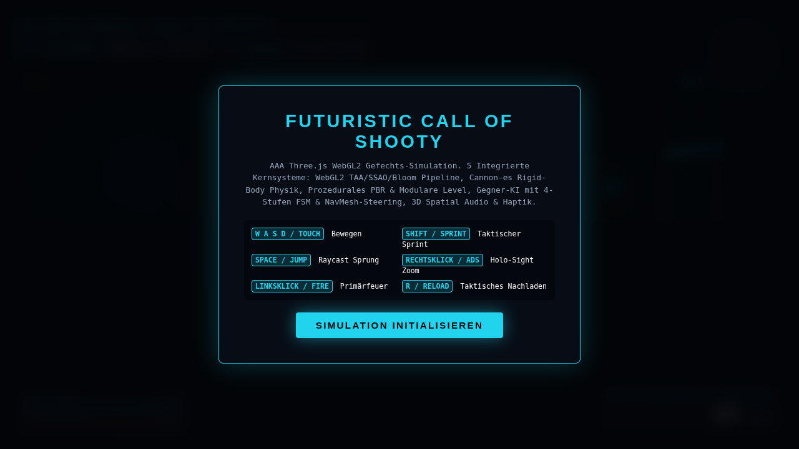
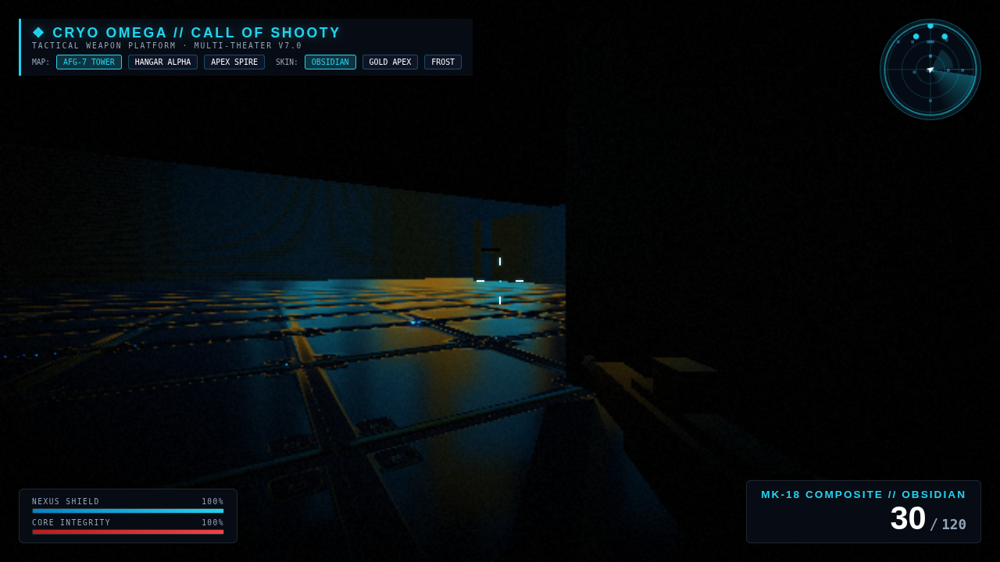
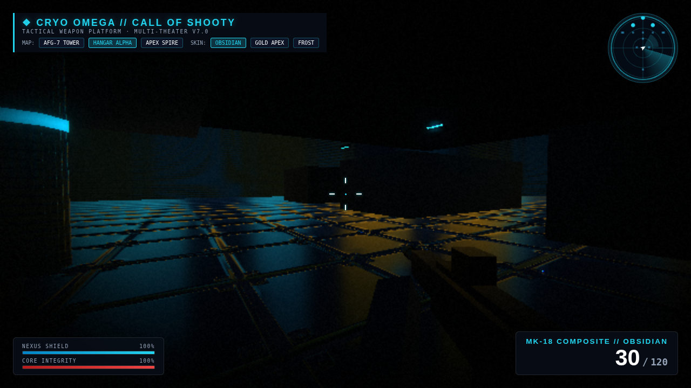
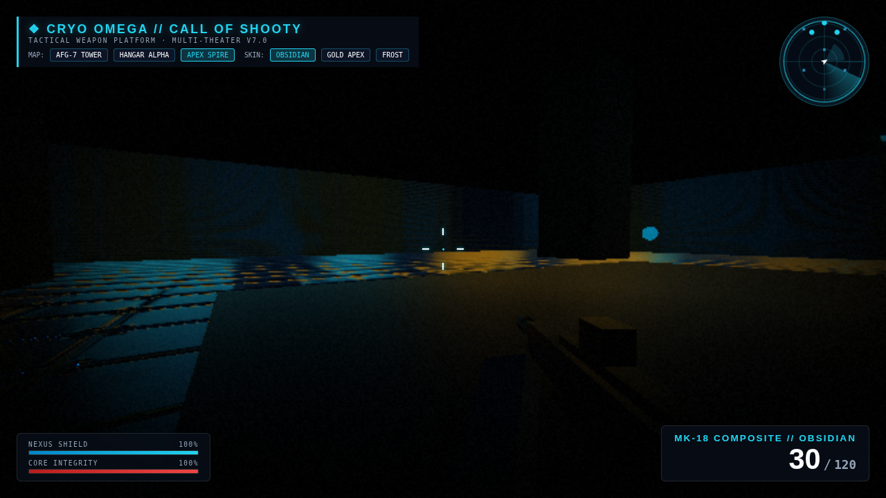
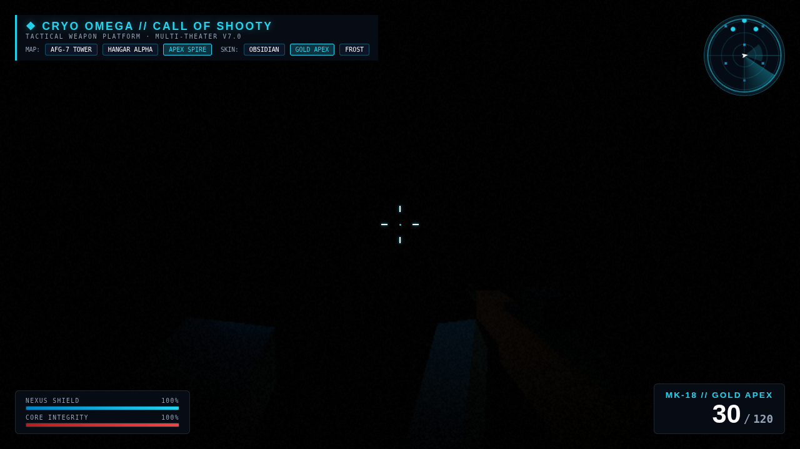
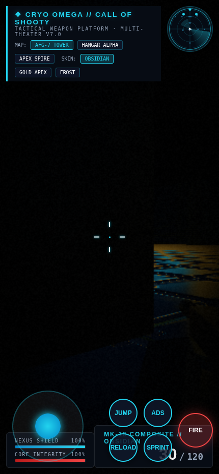
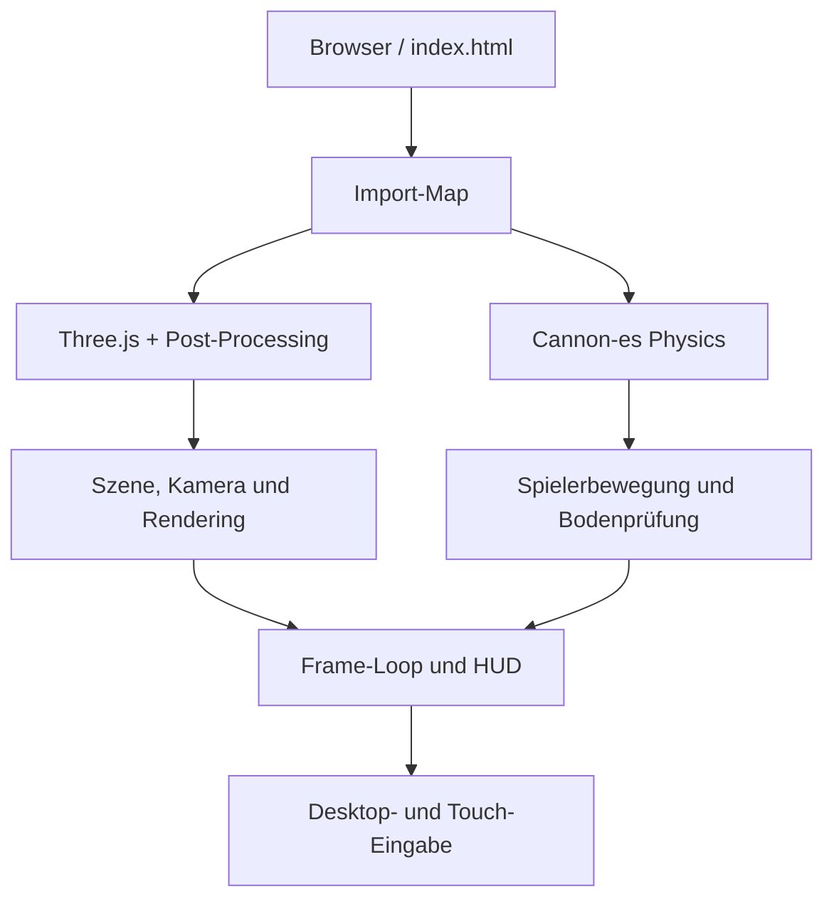

<div align="center">


# FUTURISTIC CALL OF SHOOTY

**Ein futuristischer Browser-FPS-Prototyp mit Three.js, prozeduraler Sci-Fi-Umgebung und taktischem HUD.**

[](https://github.com/Pierreg99/futuristic-call-of-shooty)
[](LICENSE)
[](https://threejs.org/)
[](ROADMAP.md)

[Features](#funktionen) · [Start](#schnellstart) · [Steuerung](#steuerung) · [Dokumentation](#dokumentation) · [Roadmap](ROADMAP.md)

</div>

---

## Überblick

**Futuristic Call of Shooty** ist ein browserbasierter First-Person-Shooter-Prototyp. Die Oberfläche kombiniert eine dunkle taktische HUD-Ästhetik mit einer prozedural aufgebauten 3D-Szene, Waffen-Viewmodel, Gegnern und Desktop- sowie Touch-Eingaben.

Das Projekt ist bewusst als direkt startbare Browser-Anwendung aufgebaut: Der Einstiegspunkt ist `index.html`; ein eigener Build-Schritt ist nicht erforderlich. Das bedeutet allerdings **nicht**, dass die Anwendung vollständig offline läuft: Three.js, Cannon-es und die verwendeten Schriftarten werden aktuell von externen CDNs geladen.

> **Projektstatus:** spielbarer Prototyp und technische Grundlage für weitere Iterationen. Die Bezeichnung „AAA“ in älteren Unterlagen ist ein Designziel, keine unabhängig bestätigte Qualitäts- oder Performance-Zertifizierung.

## Funktionen

- **3D-Rendering:** Three.js-Szene, Beleuchtung, Schatten, prozedural erzeugte Umgebungsdarstellung und Post-Processing.
- **Bewegung und Physik:** FPS-Bewegung, Sprung und Bodenprüfung auf Basis von Cannon-es.
- **Waffen-Feedback:** Viewmodel, Feuer, Nachladen, Aim-down-sights (ADS) und dynamisches Rückstoß-/Sway-Verhalten.
- **Taktische HUD-Elemente:** Fadenkreuz, Trefferindikator, Lebens-/Schildanzeige, Munition, Kill-Feed und Minimap.
- **Gegner und Gefechte:** robotische Gegner als Zieltypen für das Einzelspieler-Gefecht.
- **Karten- und Skin-Auswahl:** AFG-7 Tower, Hangar Alpha und Apex Spire sowie Obsidian-, Gold-Apex- und Frost-Varianten.
- **Touch-Eingabe:** virtueller Bewegungsstick, Touch-Look und Aktionsbuttons für kleinere Displays.
- **Eigenständige Visuals:** Projektgrafiken und mehrere Umgebungselemente werden prozedural oder als SVG im Repository bereitgestellt.

Die Funktionsliste beschreibt den Implementierungsumfang des Prototyps. Sie ist keine Aussage über plattformübergreifend abgeschlossene QA, kompetitives Multiplayer, Anti-Cheat oder garantierte Bildraten.


## Screenshots

Diese Aufnahmen werden automatisiert mit Chromium aus der echten Browser-Anwendung in `index.html` erstellt. Es handelt sich um Laufzeit-Screenshots, nicht um Mockups. Die Galerie wird bei Änderungen am Spielcode aktualisiert.

<table>
<tr>
<td width="50%" valign="top">

<p align="center"><sub>01 · Startbildschirm und Initialisierung</sub></p>
</td>
<td width="50%" valign="top">

<p align="center"><sub>02 · AFG-7 Tower — Gameplay und HUD</sub></p>
</td>
</tr>
<tr>
<td width="50%" valign="top">

<p align="center"><sub>03 · Hangar Alpha</sub></p>
</td>
<td width="50%" valign="top">

<p align="center"><sub>04 · Apex Spire</sub></p>
</td>
</tr>
<tr>
<td width="50%" valign="top">

<p align="center"><sub>05 · MK-18 — Gold Apex Skin</sub></p>
</td>
<td width="50%" valign="top">

<p align="center"><sub>06 · Mobile Ansicht mit Touch-Steuerung</sub></p>
</td>
</tr>
</table>

## Schnellstart

### Voraussetzungen

- Aktueller Browser mit WebGL-Unterstützung; für die vorgesehene Rendering-Pipeline wird WebGL2 empfohlen.
- Python 3 **oder** eine andere Möglichkeit, statische Dateien lokal über HTTP bereitzustellen.
- Internetzugriff auf die in `index.html` referenzierten CDNs für JavaScript-Module und Webfonts.

### Start mit Python

Im Repository-Verzeichnis ausführen:

```bash
python3 -m http.server 8080
```

Alternativ ist derselbe Startbefehl über das npm-Skript verfügbar:

```bash
npm start
```

Dann im Browser öffnen:

**http://localhost:8080**

Die Seite nicht direkt per `file://` öffnen: ES-Module und Import-Maps funktionieren zuverlässig über einen lokalen HTTP-Server. Beim Beenden des Servers im Terminal `Ctrl+C` drücken.

## Steuerung

| Aktion | Desktop | Touch |
|---|---|---|
| Bewegen | `W` `A` `S` `D` | Linker virtueller Stick |
| Sprint | `Shift` | Sprint-Button |
| Springen | `Space` | Jump-Button |
| Zielen (ADS) | Rechte Maustaste | ADS-Button |
| Feuern | Linke Maustaste | Fire-Button |
| Nachladen | `R` | Reload-Button |
| Umsehen | Maus bewegen | Touch-Look-Zone |

Auf dem Desktop zuerst **Simulation initialisieren** wählen. Für Pointer-Lock-Steuerung muss der Browser die entsprechende Benutzeraktion akzeptieren. Auf Touch-Geräten die Steuerungsbereiche nicht mit Browser-Zoom- oder Navigationsgesten verwechseln.

## Technischer Aufbau

Der zentrale Laufzeitcode liegt in einer einzelnen HTML-Datei. HTML, CSS, Import-Map und JavaScript-Modul sind direkt in `index.html` eingebettet.

```text
.
├── index.html                 # Anwendung, Styles, Import-Map und Spielcode
├── assets/
│   └── readme-banner.svg      # README-Titelgrafik
├── pics/                      # Architektur- und Feature-Grafiken
├── docs/                      # Architektur, Eingabe, Karten, Waffen und KI
├── audits/                    # Performance- und Accessibility-Berichte
├── reviews/                   # Kritische technische Reviews
├── PLAN.md                    # Architekturziele und Budgets
├── PROGRESS.md                # Entwicklungsverlauf
├── ROADMAP.md                 # Geplante Ausbaustufen
├── package.json               # Startskript und Metadaten
└── LICENSE                    # MIT-Lizenz
```

### Hauptkomponenten

| Bereich | Umsetzung |
|---|---|
| Rendering | Three.js `0.158.0`, WebGL, Schatten und Post-Processing |
| Physik | `cannon-es 0.20.0` |
| Umgebung | Prozedurale Canvas-Texturen und PMREM-basierte Umgebungsreflexionen |
| Eingaben | Desktop-Tastatur/Maus sowie virtuelle Touch-Steuerung |
| UI | HTML/CSS-HUD mit Statusanzeigen und Karten-/Skin-Auswahl |
| Laufzeit | Native ES-Module über Import-Map; kein Bundler erforderlich |

Die konkret verwendeten Bibliotheksversionen sind in der Import-Map in `index.html` festgelegt. Änderungen an diesen Versionen sollten zusammen mit einem Funktions- und Browser-Test erfolgen.


## Architektur auf einen Blick

Der Browser lädt die nativen ES-Module aus der Import-Map. Rendering, Physik und HUD werden in der zentralen Laufzeit von `index.html` zusammengeführt.




## Dokumentation

| Dokument | Inhalt |
|---|---|
| [Architektur](docs/ARCHITECTURE.md) | Rendering, PBR-/Normal-Map-Ansatz, Physik und Waffenkinetik |
| [Steuerung](docs/CONTROLS.md) | Desktop- und Touch-Bedienung |
| [Waffen und Skins](docs/WEAPONS_AND_SKINS.md) | Viewmodel und Skin-Konzept |
| [Robotic AI](docs/ROBOTIC_AI.md) | Gegnerkonzepte und KI-Zustände |
| [Maps und Theaters](docs/MAPS_THEATERS.md) | Umgebungsvarianten |
| [Accessibility Audit](audits/A11Y_AUDIT.md) | Dokumentierte Barrierefreiheits- und Ergonomieziele |
| [Performance Audit](audits/PERFORMANCE_BENCHMARK.md) | Dokumentierte Messwerte und Optimierungsziele |
| [Technischer Review](reviews/AUDIT-COD-CRITIC.md) | Kritische Bewertung und offene Punkte |
| [Engineering Plan](PLAN.md) | Architekturprinzipien und Zielbudgets |
| [Progress Log](PROGRESS.md) | Bisherige Entwicklungsiterationen |
| [Roadmap](ROADMAP.md) | Geplante Combat-, Netzwerk- und XR-Ausbaustufen |

### Hinweise zu Audits und Messwerten

Die Berichte im Repository sind Projektdokumentation. Ihre Messwerte sollten auf der jeweiligen Zielhardware reproduziert und mit Browser, Betriebssystem, Auflösung, Szenenzustand und Messmethode ergänzt werden, bevor sie als belastbarer Benchmark verwendet werden. Ein dokumentierter Zielwert ersetzt keinen reproduzierbaren Test.

## Qualitätssicherung und bekannte Grenzen

- `package.json` stellt derzeit ein Startskript bereit; ein standardisierter Build-, Lint- oder automatisierter Browser-E2E-Test ist nicht konfiguriert.
- Externe CDN-Module und Webfonts bedeuten, dass ein erstmaliger bzw. frischer Start Netzwerkzugriff benötigt.
- Performance hängt von GPU, Treiber, Browser, Auflösung, Schatten und Post-Processing ab.
- Die Roadmap führt Multiplayer, serverautoritative Simulation, XR und weiterführende KI als Ausbauziele. Diese Punkte dürfen nicht als bereits produktionsreif betrachtet werden.
- Vor Releases sollten Start, Kartenwechsel, Waffenaktionen, Touch-Eingaben, Resize, WebGL-Kontextverlust und längere Spielsessions manuell getestet werden.

## Mitwirken

1. Repository forken oder einen Branch für die Änderung anlegen.
2. Änderung möglichst klein und nachvollziehbar halten.
3. Start im lokalen Browser testen und Browser-/Hardware-Details bei Performance-Änderungen notieren.
4. Im Pull Request Verhalten, Testschritte, Screenshots oder kurze Aufzeichnungen und bekannte Einschränkungen angeben.


## English summary

Futuristic Call of Shooty is a browser-based first-person shooter prototype built around Three.js, procedural visuals, a tactical HUD, and desktop/touch controls.

Start a local HTTP server in the repository directory with `python3 -m http.server 8080` (or `npm start`), then open [http://localhost:8080](http://localhost:8080). Three.js, Cannon-es, and web fonts are loaded from external CDNs, so this is not a fully offline build.


## Lizenz

Dieses Projekt steht unter der [MIT-Lizenz](LICENSE).

<div align="center">
  <sub>Futuristic Call of Shooty · Pierreg99 · Cryopg.it</sub>
</div>
