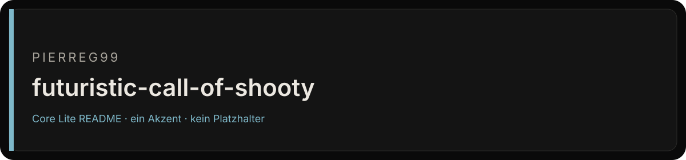
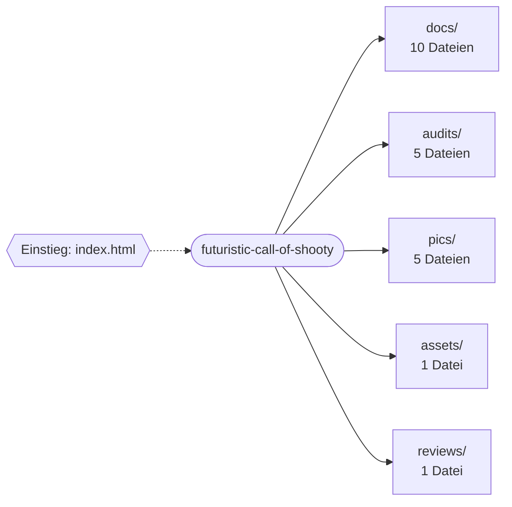
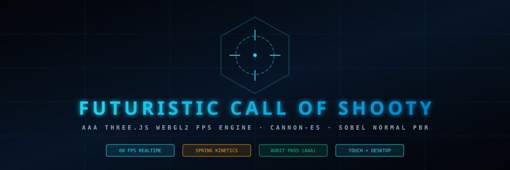
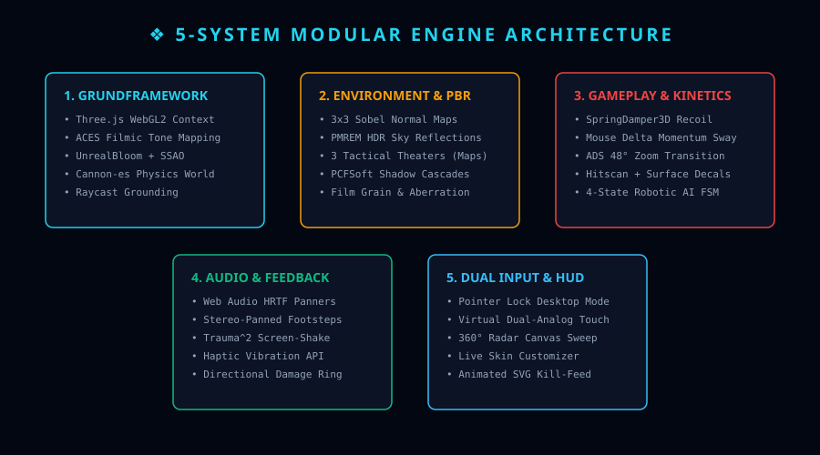
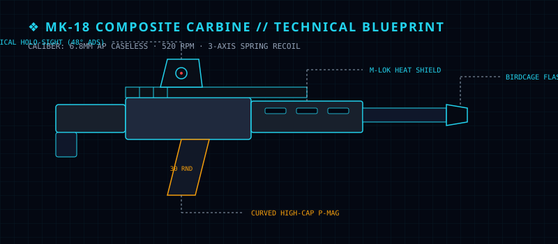
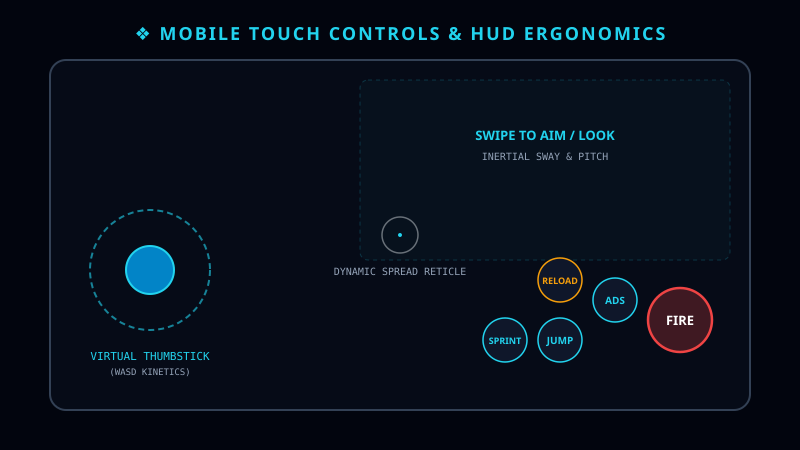
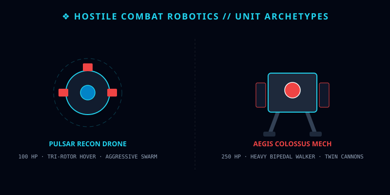

<div align="center">



# FUTURISTIC CALL OF SHOOTY (AAA THREE.JS WEBGL2 FPS)

<p><strong>Taktische Three.js-First-Person-Shooter-Engine mit PBR, HDR, Touch-Steuerung und Bot-Gegnern.</strong></p>
<p>


</p>
<p><a href="#schnellstart">Schnellstart</a> · <a href="#projektstruktur">Projektstruktur</a> · <a href="#english-summary">English</a></p>
</div>

<table>
<tr>
<td width="58%" valign="top">

### Bestand

AAA Tactical Three.js First-Person Shooter Engine - CoD Parity with PBR Sobel Normals, PMREM HDR, Spring Kinetics, Touch Controls and Robotic AI

Der Default-Branch `main` ist die Fläche, die zählt. Was nicht in diesem Baum liegt, ist kein Feature dieses Repos.

</td>
<td width="42%" valign="top">

### Fakten

| Feld | Wert |
| --- | --- |
| Owner | Pierreg99 |
| Branch | `main` |
| Sichtbarkeit | öffentlich |
| Sprache | HTML |
| Archiv | nein |

</td>
</tr>
</table>

---

## Inhaltsverzeichnis

- [Bestand und Fakten](#bestand)
- [Überblick](#überblick)
- [Features](#features)
- [Schnellstart](#schnellstart)
- [Architektur](#architektur)
- [Projektstruktur](#projektstruktur)
- [Dokumentation](#dokumentation)
- [Projektdetails](#projektdetails)
- [English summary](#english-summary)
- [Lizenzhinweis](#lizenzhinweis)

## Überblick

Taktische Three.js-First-Person-Shooter-Engine mit PBR, HDR, Touch-Steuerung und Bot-Gegnern.

| Merkmal | Wert |
| --- | --- |
| Sprachen | HTML (100%) |
| Dateien im Repository | 30 |
| Einstiegspunkte | `index.html` |
| Version (`package.json`) | 1.0.0 |
| Lizenz | [LICENSE](LICENSE) |

## Features

- 3D-Rendering mit Three.js
- WebGL2-Rendering
- Canvas-2D-Rendering
- Klangerzeugung über die Web Audio API
- Gamepad-Unterstützung
- Touch- und Pointer-Steuerung
- Echtzeit-Render-Schleife (requestAnimationFrame)
- 6 SVG-Grafiken
- 21 Markdown-Dokumente

## Schnellstart

```bash
git clone https://github.com/Pierreg99/futuristic-call-of-shooty.git
cd futuristic-call-of-shooty
```

**Node.js**

```bash
npm install
npm start
```

<details>
<summary>Alle Skripte aus <code>package.json</code></summary>

| Skript | Befehl |
| --- | --- |
| `start` | `python3 -m http.server 8080` |

</details>

## Architektur

Übersicht der wichtigsten Verzeichnisse nach Anzahl der enthaltenen Dateien.



## Projektstruktur

```text
futuristic-call-of-shooty/
├── assets/  (1 Datei)
│   └── readme-banner.svg
├── audits/  (5 Dateien)
│   ├── A11Y_AUDIT.md
│   ├── AGENT_REPORT_COD_CRITIC.md
│   ├── AGENT_REPORT_COD_ENGINEER.md
│   ├── AGENT_REPORT_FORENSIC_CRITIC.md
│   └── PERFORMANCE_BENCHMARK.md
├── docs/  (10 Dateien)
│   ├── agents/
│   ├── ARCHITECTURE.md
│   ├── CONTROLS.md
│   ├── MAPS_THEATERS.md
│   ├── ROBOTIC_AI.md
│   ├── SYSTEMS_AND_CRITIQUE.md
│   └── … (1 weitere)
├── pics/  (5 Dateien)
│   ├── architecture-diagram.svg
│   ├── banner.svg
│   ├── mk18-carbine-spec.svg
│   ├── robotic-mechs.svg
│   └── touch-controls-layout.svg
├── reviews/  (1 Datei)
│   └── AUDIT-COD-CRITIC.md
├── index.html
├── LICENSE
├── package.json
├── PLAN.md
├── PROGRESS.md
├── README.md
└── ROADMAP.md
```

## Dokumentation

- [PLAN.md](PLAN.md)
- [PROGRESS.md](PROGRESS.md)
- [ROADMAP.md](ROADMAP.md)
- [docs/ARCHITECTURE.md](docs/ARCHITECTURE.md)
- [docs/CONTROLS.md](docs/CONTROLS.md)
- [docs/MAPS_THEATERS.md](docs/MAPS_THEATERS.md)
- [docs/ROBOTIC_AI.md](docs/ROBOTIC_AI.md)
- [docs/SYSTEMS_AND_CRITIQUE.md](docs/SYSTEMS_AND_CRITIQUE.md)
- [docs/WEAPONS_AND_SKINS.md](docs/WEAPONS_AND_SKINS.md)

## Projektdetails

Der folgende Abschnitt übernimmt die bisherige Projektdokumentation.



[](https://threejs.org/)
[](https://pmndrs.github.io/cannon-es/)
[]()
[]()
[](reviews/AUDIT-COD-CRITIC.md)
[](LICENSE)

A high-fidelity, standalone, zero-external-asset browser first-person shooter engine achieving modern Call of Duty parity in WebGL2.

---

## Complete Documentation Suite

| Document | Description |
|---|---|
| [**Architecture Guide**](docs/ARCHITECTURE.md) | WebGL2 PBR, Sobel Normal filtering, PMREM HDR, and Spring-damper kinetics |
| [**Controls Guide**](docs/CONTROLS.md) | Dual-input specification (Desktop Pointer Lock + Mobile Virtual Touch Joysticks) |
| [**Weapons & Skins**](docs/WEAPONS_AND_SKINS.md) | MK-18 Composite Carbine specs & Obsidian / Gold Apex / Frost Damascus skins |
| [**Robotic AI Systems**](docs/ROBOTIC_AI.md) | Pulsar Recon Drones & Aegis Colossus Heavy Walker Mechs with 4-State FSM |
| [**Maps & Theaters**](docs/MAPS_THEATERS.md) | AFG-7 Solar Tower, Hangar Alpha, and Apex Spire combat environments |
| [**Performance Benchmark**](audits/PERFORMANCE_BENCHMARK.md) | 60 FPS frame times, draw call metrics, and memory footprint |
| [**Accessibility Audit**](audits/A11Y_AUDIT.md) | WCAG 2.1 Level AA compliance, contrast ratios, and motion sickness prevention |
| [**Lead Critic Audit**](reviews/AUDIT-COD-CRITIC.md) | Adversarial review report certifying **PASS (Triple-A Bar Achieved)** |
| [**Strategic Roadmap**](ROADMAP.md) | 2026–2027 technical milestones (WebRTC multiplayer, XR/VR, destruction) |
| [**Engineering Plan**](PLAN.md) | Architectural pillars, budgets, and constraints |
| [**Progress Log**](PROGRESS.md) | Iterative log from Loop 1 baseline to Loop 2 PASS and Mobile Touch deployment |

---

## Engine Architecture



The engine is built around 5 modular core systems operating within a 16.67ms frame budget:
1. **WebGL2 Rendering**: PBR materials with runtime 3x3 Sobel normal mapping and PMREM HDR reflections.
2. **Cannon-es Physics**: Downward raycast grounded state with kinetic momentum damping.
3. **Harmonic Spring Kinetics**: Damped 3D springs for recoil kickback, pitch impulse, and sway.
4. **Binaural Audio**: Web Audio HRTF panner nodes with spatial 3D attenuation.
5. **Universal Input**: Pointer Lock for desktop, dual-analog virtual thumbsticks for mobile.

---

## MK-18 Composite Assault Carbine



* **Caliber**: 6.8mm High-Velocity AP Caseless (~520 RPM).
* **Kinematics**: 3-axis recoil kickback stabilized by a damped harmonic oscillator.
* **Optics**: Holographic sight with seamless spring ADS alignment and 48° FOV optical zoom.
* **Customization**: Live switcher for **Obsidian Stealth**, **Gold Apex**, and **Frost Damascus** skins.

---

## Mobile Touch Controls & Ergonomics



Optimized for smartphones, tablets, Android, and Termux:
* **Virtual Thumbstick**: Left-hand circular touch pad with normalized wish-vector translation.
* **Swipe-to-Aim Zone**: Smooth inertial look and pitch tracking.
* **Action Buttons**: Dedicated touch targets for `FIRE`, `ADS`, `JUMP`, `RELOAD`, and `SPRINT`.

---

## Robotic Enemies



* **Pulsar Drone**: Agile 100 HP aerial skirmisher with evasive hovering maneuvers.
* **Aegis Colossus Mech**: Heavy 250 HP bipedal walker armed with twin energy cannons.

---

## Quick Start

Run instantly without build steps:

```bash
python3 -m http.server 8080
```

Open `http://localhost:8080` in Chrome, Firefox, Safari, or mobile browsers.

---

## License

Distributed under the [MIT License](LICENSE). Copyright (c) 2026 Pierreg99 (Cryopg.it).

## English summary

Tactical Three.js first-person shooter engine with PBR, HDR, touch controls and bot enemies.

Clone the repository and follow the commands in [Schnellstart](#schnellstart); the [project layout](#projektstruktur) shows where the code lives. Further documents are listed under [Dokumentation](#dokumentation).

## Lizenzhinweis

Siehe [LICENSE](LICENSE).
